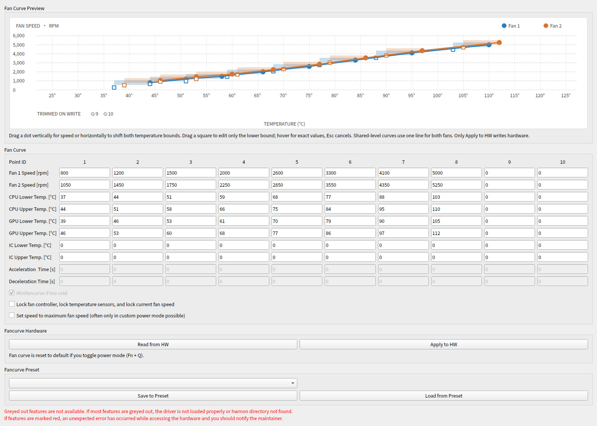
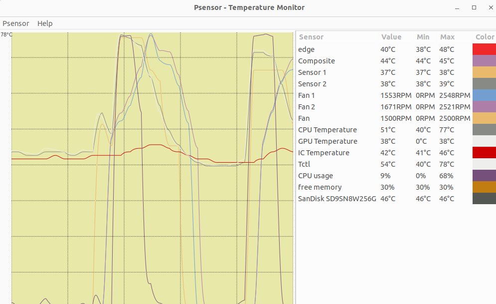
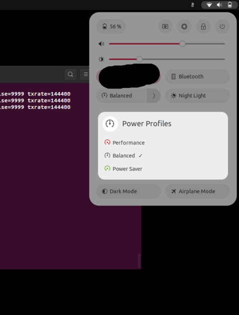

<h1 align="left">
  <a href="https://github.com/johnfanv2/LenovoLegionLinux" target="_blank">
    <picture>
      <source media="(prefers-color-scheme: light)" srcset="https://raw.githubusercontent.com/johnfanv2/LenovoLegionLinux/HEAD/docs/assets/legion_logo_dark.svg">
      <source media="(prefers-color-scheme: dark)" srcset="https://raw.githubusercontent.com/johnfanv2/LenovoLegionLinux/HEAD/docs/assets/legion_logo_light.svg">
      
    </picture>
  </a>
    <strong> Lenovo Legion Linux Support </strong>
</h1>

[](https://github.com/johnfanv2/LenovoLegionLinux/actions/workflows/build.yml)
[](https://discord.com/invite/legionseries)
[](https://www.reddit.com/r/LenovoLegion/)
[](https://www.reddit.com/r/linuxhardware/)
</br>
[](https://tracker.debian.org/pkg/lenovolegionlinux)
[](https://copr.fedorainfracloud.org/coprs/francoism/lenovolegionlinux/)
[](https://aur.archlinux.org/packages/lenovolegionlinux-git)
[](https://aur.archlinux.org/packages/lenovolegionlinux-dkms-git)
[](https://gitweb.gentoo.org/repo/proj/guru.git/)
[](https://gpo.zugaina.org/sys-firmware/lenovolegionlinux)
[](https://search.nixos.org/packages?channel=unstable&from=0&size=50&sort=relevance&type=packages&query=lenovo-legion)
</br>
[](https://nobaraproject.org/)
[](https://pika-os.com/)
---

#### Other language versions of this README file:

* [简体中文版简介](README_zh-hans.md)

---

**This project is not affiliated with Lenovo in any way**

Lenovo Legion Linux (LLL) brings additional drivers and tools for Lenovo Legion series laptops to Linux. It
is the alternative to Lenovo Vantage or Legion Zone (both Windows only).

It allows you to control features like the fan curve, power mode, power limits, rapid charging, and more. This has been achieved through reverse engineering and disassembling the ACPI firmware, as well as the firmware and memory of the embedded controller (EC).

:star: **Please star this repository if this is useful or might be useful in the future.**

:star2: **My goal is to merge the driver into the main Linux kernel so it comes automatically with Linux and no recompilation is required after a Linux update**

:boom: **Starring shows that this is useful to me and the Linux community so hopefully a merge into the Kernel is possible.**

## :rocket: Features

<p align="center">
    
    
    
</p>

- [X] Light on RAM and CPU and without telemetry
- [X] Fully controllable using scripts or from the command-line
- [X] Simple GUI replacement for Lenovo Vantage: Fan curve, FN Lock, Win Key, Touchpad Power, Camera Power, Battery Conservation, Rapid Charging, Charge output from always on USB, Display Overdrive (only shown when the firmware reports that the panel supports it; not on OLED panels such as the Legion Pro 7 16IAX10H's), Y-Logo LED Light, IO-Port LED Light, Hybrid Mode (GSync), CPU and GPU Overclock:
    - Switch battery conservation mode; keep battery at 60% when on AC to prolong battery life (https://bugs.kde.org/show_bug.cgi?id=441057)
    - Toggle Fn lock; Use special function on F1-F12 keys without pressing the Fn key
    - Enable or disable touchpad
- [X] Set a fully featured custom fan curve with up to 10 points:
  - Set temperature points for when the fan speed (level) should change
  - Use CPU, GPU and IC temperature to control the fan all at the same time
  - Set the fan speed (RPM) at each level
  - Even allows speed below 1600 RPM
  - Set minimum temperature for each level that must be fallen below before slowing down the fans again
  - Set acceleration and deceleration for each the fan when the fan speed should increase or decrease
  - Save and load presets for different modes
- [X] Lock and unlock the fan controller and fan speed
- [X] Lift the firmware-imposed fan ceiling on supported models (`fan_unlock` sysfs / `legion_cli fan-unlock-{enable,disable,status}`). On the Legion Pro 7 16IRX8H (BIOS KWCN54WW) this raises the cap from ~4400 RPM to ~7100 RPM. Discovered via `WMAA(0, 0x0D, 0x01)` — see issue #429. The sysfs node is gated behind a `has_fan_unlock` model/BIOS allowlist and only exposed on validated firmwares (currently KWCN54WW).
- [X] Instant Boot: power the laptop on when an AC adapter (`instant_boot_ac`) or a USB-PD charger (`instant_boot_usb_pd`) is connected (`legion_cli instant-boot-{ac,usb-pd}-{enable,disable,status}`, GUI "Other Options"). Exposed only where the DSDT implements the WMI feature ids 0x03010001/0x03010002 (`has_instant_boot`, currently the Legion Pro 7 16IAX10H / Q7CN and 16AFR10H / SMCN, and the Legion 5 15IRX10 / QNCN).
- [X] Switch power mode (quiet, balanced, performance) using software
  - Now you can do it using software in your system settings
  - Changing with `Fn+Q` is also possible
  - Depending on your desktop environment, you could automatically switch to quiet mode if you are on battery or performance mode when on AC power (e.g. KDE's Energy Saving settings)
  - Switch between different fan profiles depending on the power profile (See: [Lenovo Legion Laptop Support Daemon](docs/usage.md#lenovo-legion-laptop-support-daemonlegiond))
- [X] Monitor fan speeds and temperatures (CPU, GPU, IC) using the now available sensors
- [X] Enable or disable automatic switching to a "Mini Fan Curve" if temperatures are low for a long time
- [X] **SmartFan** — lightweight shell-based fan daemon for Legion 7 Gen 10+ using `acpi_call` (no full kernel module needed). 4 modes, smooth ramping, LED sync, TUI switcher. See [`extra/smartfan/`](extra/smartfan/)

## :mega: Overview

- it comes with a driver (kernel module) that implements the Linux standard interfaces (sysfs, debugfs, hwmon)
- using standard Linux interfaces makes it is compatible with the command line/file interface or standard GUI tools like psensor
- compared to vendor tools for Windows, it even allows to set the fan curve. This allows to keep the fans
  slowly and quietly running instead of constantly switching between fans off and loud fans. Perfect for quiet office work. :office:

## :package: Installation

### Distribution packages

- Debian/Ubuntu:
  - Debian repo (for now): [here](https://tracker.debian.org/pkg/lenovolegionlinux)
- Fedora/RHEL Base Distros:
    - Fedora COPR (community-maintained): [here](https://copr.fedorainfracloud.org/coprs/francoism/lenovolegionlinux/)
- Arch Base Distros:
    - [lenovolegionlinux-git](https://aur.archlinux.org/packages/lenovolegionlinux-git)
    - [lenovolegionlinux-dkms-git](https://aur.archlinux.org/packages/lenovolegionlinux-dkms-git)
- Gentoo Base Distros:
    - [GURU Overlay](https://gitweb.gentoo.org/repo/proj/guru.git)
    - [ebuild](https://gpo.zugaina.org/sys-firmware/lenovolegionlinux)
- [NixOS](https://search.nixos.org/packages?channel=unstable&from=0&size=50&sort=relevance&type=packages&query=lenovo-legion)

### Build from source

```bash
git clone https://github.com/johnfanv2/LenovoLegionLinux.git
cd LenovoLegionLinux/kernel_module
make
sudo make reloadmodule
```

Install the build dependencies for your distribution first, then run the
[initial usage tests](docs/initial-testing.md) before installing permanently
or via DKMS. See the [installation guide](docs/installation.md) for
dependencies per distribution, DKMS, Secure Boot and uninstalling.

## :pushpin: Supported Models

Lenovo Legion models from 2020 up to the latest 2025 models probably work, and
several LOQ models are supported as well. If your BIOS version has the same
leading letters as a confirmed model, e.g. EFCN (like EFCN54WW), it will
probably work. See [Compatible Models](docs/compatible-models.md) for the
confirmed models and their supported features; the complete list is the DMI
allowlist in [`kernel_module/legion-laptop.c`](kernel_module/legion-laptop.c).
If you want to confirm that your model works or if it does not work, please
raise an issue.

## :books: Documentation

| Guide | Contents |
| --- | --- |
| [Installation](docs/installation.md) | Dependencies, build, permanent install, DKMS, Secure Boot, uninstall |
| [Initial Usage Testing](docs/initial-testing.md) | Check that the module loads, reads sensors and the fan curve, and writes the fan curve |
| [Usage](docs/usage.md) | Monitoring, fan curves (GUI, CLI, script), power modes, `legiond`, fan unlock, battery, Fn lock, touchpad, keyboard backlight |
| [Compatible Models](docs/compatible-models.md) | Confirmed models and their supported features |
| [FAQ](docs/faq.md) | Temperatures, fan behavior, power modes, BIOS/EC reset, troubleshooting |
| [Known Issues](docs/known-issues.md) | Firmware limitations of the fan curve interfaces |
| [Features and Testing](docs/FEATURES_AND_TESTING.md) | Per-model and per-feature notes and hardware test procedures |
| [Overview for Developers](docs/developers.md) | The components of this project |
| [Reverse Engineering](docs/REVERSE_ENGINEER.md) | Collecting WMI/ACPI/EC data for new models |
| [Test Plan](docs/TESTPLAN.md) | Manual test plan |
| [Credits](docs/credits.md) | Basis of this work, contributors and tools based on LLL |

## :handshake: Contributing

**Pull requests are very welcome!** Filing an issue alone is helpful, but there is only so much developers can do without access to your hardware — especially for "does not work on my model" reports. If you can, please try to fix it yourself:

1. Clone the repo and modify the code locally (e.g. add your model to the DMI allowlist in `kernel_module/legion-laptop.c`). AI coding assistants work well for this — the repo ships an [AGENTS.md](AGENTS.md) with build and test instructions written for them.
2. Test it on your own laptop until everything works (see the verification commands in [AGENTS.md](AGENTS.md) and the [initial usage tests](docs/initial-testing.md)).
3. Open a pull request that references your issue.

Most of the model support in this project was contributed exactly this way. Also see [CONTRIBUTING.md](CONTRIBUTING.md).

## :warning: Disclaimer

- **the tool comes with no warranty. Use at your own risk.**
- **this project is not affiliated with Lenovo in any way.**
- this is a small hobby project; please be patient and read through this README and the [documentation](docs/README.md) carefully before you ask for support
- if your Lenovo Legion laptop is not supported and you are ready to perform some tests please notify me
- this is a Linux only tool and will probably not run in WSL; for Windows use one of the available Windows tools
  - [LenovoLegionToolkit](https://github.com/BartoszCichecki/LenovoLegionToolkit)
  - [LegionFanControl](https://www.legionfancontrol.com/)

## Star History

<a href="https://www.star-history.com/?repos=johnfanv2%2Flenovolegionlinux&type=date&legend=top-left">
 <picture>
   <source media="(prefers-color-scheme: dark)" srcset="https://api.star-history.com/chart?repos=johnfanv2/lenovolegionlinux&type=date&theme=dark&legend=top-left" />
   <source media="(prefers-color-scheme: light)" srcset="https://api.star-history.com/chart?repos=johnfanv2/lenovolegionlinux&type=date&legend=top-left" />
   
 </picture>
</a>

## Legal Matters

Reference to any Lenovo products, services, processes, or other information and/or use of Lenovo Trademarks does not constitute or imply endorsement, sponsorship, or recommendation thereof by Lenovo.

The use of Lenovo®, Lenovo Legion™, Yoga®, IdeaPad® or other trademarks within this website and associated tools and libraries is only to provide a recognisable identifier to users to enable them to associate that these tools will work with Lenovo laptops.
