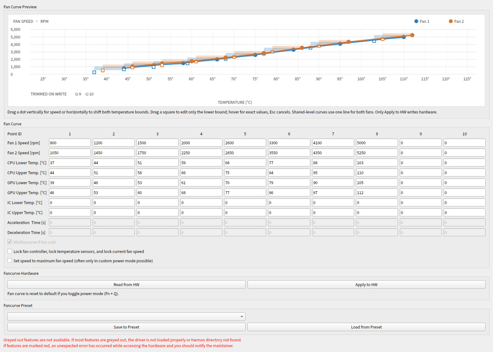
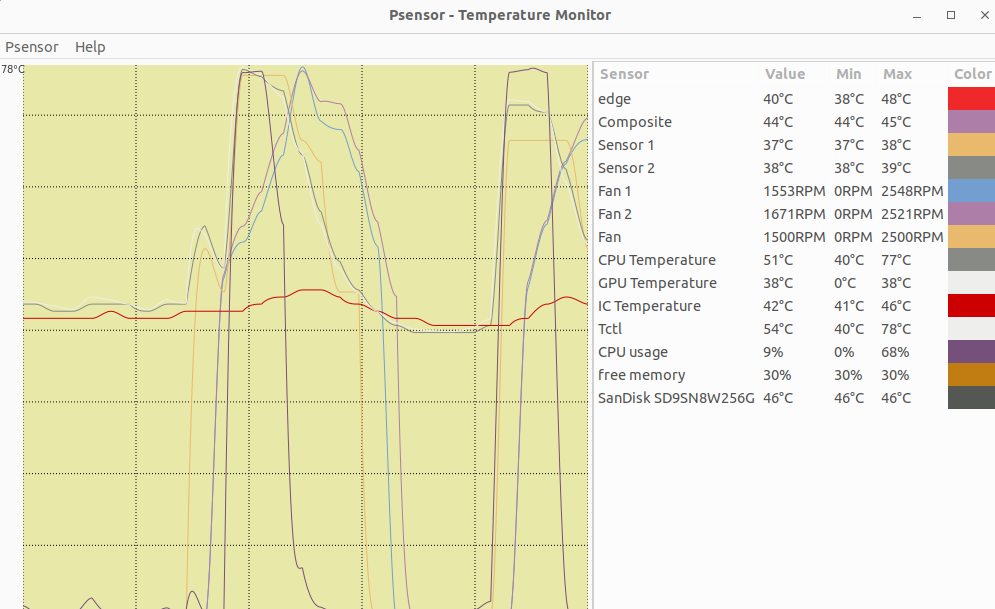
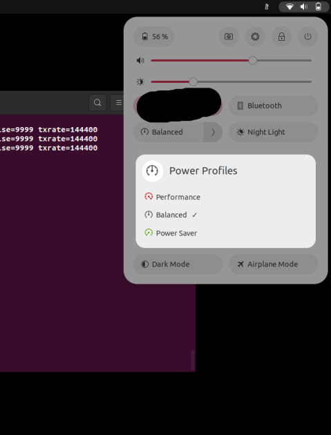

<h1 align="left">
  <a href="https://github.com/johnfanv2/LenovoLegionLinux" target="_blank">
    <picture>
      <source media="(prefers-color-scheme: light)" srcset="https://raw.githubusercontent.com/johnfanv2/LenovoLegionLinux/HEAD/docs/assets/legion_logo_dark.svg">
      <source media="(prefers-color-scheme: dark)" srcset="https://raw.githubusercontent.com/johnfanv2/LenovoLegionLinux/HEAD/docs/assets/legion_logo_light.svg">
      
    </picture>
  </a>
    <strong> 联想拯救者 Linux 支持 </strong>
</h1>

[](https://github.com/johnfanv2/LenovoLegionLinux/actions/workflows/build.yml)
[](https://discord.com/invite/legionseries)
[](https://www.reddit.com/r/LenovoLegion/)
[](https://www.reddit.com/r/linuxhardware/)
</br>
[](https://tracker.debian.org/pkg/lenovolegionlinux)
[](https://copr.fedorainfracloud.org/coprs/francoism/lenovolegionlinux/)
[](https://aur.archlinux.org/packages/lenovolegionlinux-git)
[)](https://aur.archlinux.org/packages/lenovolegionlinux-dkms-git)
[](https://gitweb.gentoo.org/repo/proj/guru.git/)
[](https://gpo.zugaina.org/sys-firmware/lenovolegionlinux)
[](https://search.nixos.org/packages?channel=unstable&from=0&size=50&sort=relevance&type=packages&query=lenovo-legion)
</br>
[](https://nobaraproject.org/)
[](https://pika-os.com/)
---

#### 本README文件的其他语言版本：

* [English Version](README.md)

---

**本项目与联想(Lenovo)官方无任何关联**  

Lenovo Legion Linux（LLL）为联想拯救者系列笔记本提供了额外的Linux驱动和工具集，可作为Windows专属的"Lenovo Vantage"和"Legion Zone"控制软件的替代方案。  

通过逆向工程和反汇编ACPI固件、嵌入式控制器(EC)的固件与内存，本项目实现了以下功能控制：  
- 风扇曲线调节  
- 性能模式切换  
- 功耗限制调整  
- 快速充电管理  
- 及其他高级功能  

:star: **如果本项目对您有帮助或可能有潜在价值，请为仓库点赞（Star）**  

:star2: **我们的终极目标是将驱动整合进Linux内核主线，未来无需在系统更新后重新编译驱动**  

:boom: **您的点赞将向Linux社区证明该项目的价值，推动驱动进入官方内核的进程**  

## :rocket: 功能特性  

<p align="center">
    
    
    
</p>

- [x] 占用内存和 CPU 极小，无遥测
- [x] 可完全通过脚本或命令行控制
- [x] 替代 Lenovo Vantage 的简单 GUI：风扇曲线、Fn 锁、Win 键、触控板电源、摄像头电源、电池养护、快速充电、始终开启 USB 充电输出、显示器超频（仅在固件报告屏幕支持时显示；OLED 屏幕如拯救者 Pro 7 16IAX10H 不支持）、Y-Logo 灯光、IO 端口灯光、混合模式 (GSync)、CPU/GPU 超频：
  - 切换电池养护模式；接入电源时保持电池在 60%，延长电池寿命（https://bugs.kde.org/show_bug.cgi?id=441057）
  - 切换 Fn 锁；无需按 Fn 键即可使用 F1-F12 的特殊功能
  - 启用或禁用触控板
- [x] 设置最多 10 点的完整自定义风扇曲线：
  - 设置各温度节点对应的风扇转速（等级）变化点
  - 可同时用 CPU、GPU 和 IC 温度控制风扇
  - 每一级可设置风扇转速（RPM）
  - 支持 1600 RPM 以下的转速
  - 设置每一级风扇降速所需低于的最低温度
  - 分别设置风扇加速和减速的响应参数
  - 支持不同模式下的预设保存与加载
- [x] 锁定和解锁风扇控制器与风扇转速
- [x] 在受支持的机型上解除固件风扇转速上限（`fan_unlock` sysfs / `legion_cli fan-unlock-{enable,disable,status}`）。在 Legion Pro 7 16IRX8H（BIOS KWCN54WW）上可将上限从约 4400 RPM 提升至约 7100 RPM。该功能通过 `WMAA(0, 0x0D, 0x01)` 发现 —— 见 issue #429。此 sysfs 节点由 `has_fan_unlock` 机型/BIOS 白名单控制，仅在经过验证的固件上暴露（目前为 KWCN54WW）。
- [x] 即时开机（Instant Boot）：接入电源适配器（`instant_boot_ac`）或 USB-PD 充电器（`instant_boot_usb_pd`）时自动开机（`legion_cli instant-boot-{ac,usb-pd}-{enable,disable,status}`，GUI“其他选项”）。仅在 DSDT 实现了 WMI 功能 ID 0x03010001/0x03010002 的机型上暴露（`has_instant_boot`，目前为拯救者 Pro 7 16IAX10H / Q7CN 与 16AFR10H / SMCN，以及拯救者 Legion 5 15IRX10 / QNCN）。
- [x] 通过软件切换电源模式（静音、平衡、高性能）
  - 现在可在系统设置中通过软件切换
  - 也可通过 `Fn+Q` 切换
  - 根据桌面环境，可实现如在电池下自动切入静音模式，接电源时自动切入高性能模式（如 KDE 的节能设置）
  - 可根据电源配置文件自动切换不同风扇曲线（见：[Lenovo Legion Linux 守护进程（legiond）](docs/zh-hans/usage.md#lenovo-legion-linux-守护进程legiond)）
- [x] 通过新增的传感器监控风扇转速和温度（CPU、GPU、IC）
- [x] 启用或禁用在长时间低温下自动切换为“迷你风扇曲线”
- [x] **SmartFan** —— 面向 Legion 7 Gen 10+ 的轻量级 shell 风扇守护进程，基于 `acpi_call`（无需完整内核模块）。4 种模式、平滑调速、LED 同步、TUI 切换器。见 [`extra/smartfan/`](extra/smartfan/)

---

## :mega: 项目架构  
- **标准化驱动模块**：通过Linux标准接口（sysfs/debugfs/hwmon）实现  
- **全兼容设计**：  
  - 命令行操作（直接文件读写）  
  - 完美适配psensor等主流监控工具  
- **超越Windows原厂工具**：  
  - 彻底解决风扇"启停式噪音"问题  
  - 办公场景下实现持续低噪运行  

---

## :package: 安装

### 发行版软件包

- Debian/Ubuntu：
  - Debian 仓库（临时）：[地址](https://tracker.debian.org/pkg/lenovolegionlinux)
- Fedora/RHEL 系列发行版：
    - Fedora COPR（社区维护）：[地址](https://copr.fedorainfracloud.org/coprs/francoism/lenovolegionlinux/)
- Arch 系列发行版：
    - [lenovolegionlinux-git](https://aur.archlinux.org/packages/lenovolegionlinux-git)
    - [lenovolegionlinux-dkms-git](https://aur.archlinux.org/packages/lenovolegionlinux-dkms-git)
- Gentoo 系列发行版：
    - [GURU Overlay](https://gitweb.gentoo.org/repo/proj/guru.git)
    - [ebuild](https://gpo.zugaina.org/sys-firmware/lenovolegionlinux)
- [NixOS](https://search.nixos.org/packages?channel=unstable&from=0&size=50&sort=relevance&type=packages&query=lenovo-legion)

### 从源码构建

```bash
git clone https://github.com/johnfanv2/LenovoLegionLinux.git
cd LenovoLegionLinux/kernel_module
make
sudo make reloadmodule
```

请先安装所用发行版的构建依赖，并在永久安装或使用 DKMS 安装之前完成
[初次使用测试](docs/zh-hans/initial-testing.md)。各发行版依赖、DKMS、安全启动和卸载方法见
[安装指南](docs/zh-hans/installation.md)。

## :pushpin: 支持的型号

从 2020 年到最新的 2025 款联想拯救者机型大概率都能兼容，部分 LOQ 机型也已支持。如果你的 BIOS
版本前缀与已确认型号相同，例如 EFCN（如 EFCN54WW），那很可能也能兼容。已确认的型号及其支持的功能见
[兼容型号](docs/zh-hans/compatible-models.md)；完整列表见
[`kernel_module/legion-laptop.c`](kernel_module/legion-laptop.c) 中的 DMI 白名单。如果你想确认你的型号是否可用，或发现不可用，请提交 issue。

## :books: 文档

| 指南 | 内容 |
| --- | --- |
| [安装](docs/zh-hans/installation.md) | 依赖、构建、永久安装、DKMS、安全启动、卸载 |
| [初次使用测试](docs/zh-hans/initial-testing.md) | 检查模块加载、传感器与风扇曲线读取，以及风扇曲线写入 |
| [使用指南](docs/zh-hans/usage.md) | 监控、风扇曲线（GUI、CLI、脚本）、电源模式、`legiond`、风扇解锁、电池、Fn 锁、触控板、键盘背光 |
| [兼容型号](docs/zh-hans/compatible-models.md) | 已确认的型号及其支持的功能 |
| [常见问题解答](docs/zh-hans/faq.md) | 温度、风扇行为、电源模式、BIOS/EC 重置、故障排查 |
| [已知问题](docs/zh-hans/known-issues.md) | 风扇曲线接口的固件限制 |
| [Features and Testing](docs/FEATURES_AND_TESTING.md)（英文） | 各机型、各功能的说明与硬件测试步骤 |
| [开发者概览](docs/zh-hans/developers.md) | 本项目的组成部分 |
| [Reverse Engineering](docs/REVERSE_ENGINEER.md)（英文） | 为新机型收集 WMI/ACPI/EC 数据 |
| [Test Plan](docs/TESTPLAN.md)（英文） | 手动测试计划 |
| [鸣谢](docs/zh-hans/credits.md) | 本项目基础、贡献者及基于 LLL 的工具 |

## :handshake: 参与贡献

**非常欢迎提交 PR！** 只提 issue 虽然也有帮助，但开发者手头没有你的硬件，能做的事情非常有限 —— 尤其是“在我的机型上无法使用”这类报告。如果条件允许，请尝试自己动手修复：

1. 克隆仓库并在本地修改代码（例如把你的机型加入 `kernel_module/legion-laptop.c` 的 DMI 白名单）。借助常用的 AI 编程工具会更轻松 —— 仓库自带 [AGENTS.md](AGENTS.md)，里面有专门为 AI 准备的构建和测试说明。
2. 在你自己的电脑上测试，直到功能正常（验证命令见 [AGENTS.md](AGENTS.md) 及[初次使用测试](docs/zh-hans/initial-testing.md)）。
3. 发起 Pull Request，并在描述中引用相关 issue。

本项目中大部分机型的支持正是通过这种方式加入的。另请参阅 [CONTRIBUTING.md](CONTRIBUTING.md)。

## :warning: 免责声明

- **本工具不提供任何担保，使用风险自负。**
- **本项目与联想公司无任何关联。**
- 这是一个小型业余项目，请耐心等待，并在寻求支持前仔细阅读本说明文档及[文档](docs/zh-hans/README.md)
- 如果你的联想拯救者笔记本暂不支持，且你愿意协助测试，请联系我
- 该工具仅支持Linux系统，可能无法在WSL下运行；如需Windows支持，请使用以下Windows工具：
  - [LenovoLegionToolkit](https://github.com/BartoszCichecki/LenovoLegionToolkit)
  - [LegionFanControl](https://www.legionfancontrol.com/)

## Star 历史

<a href="https://www.star-history.com/?repos=johnfanv2%2Flenovolegionlinux&type=date&legend=top-left">
 <picture>
   <source media="(prefers-color-scheme: dark)" srcset="https://api.star-history.com/chart?repos=johnfanv2/lenovolegionlinux&type=date&theme=dark&legend=top-left" />
   <source media="(prefers-color-scheme: light)" srcset="https://api.star-history.com/chart?repos=johnfanv2/lenovolegionlinux&type=date&legend=top-left" />
   
 </picture>
</a>

## 法律声明

本项目中对任何联想产品、服务、流程或其它信息的引用，以及对联想商标的使用，并不构成或暗示联想对本项目的认可、赞助或推荐。

在本网站及相关工具和库中使用 Lenovo®、Lenovo Legion™、Yoga®、IdeaPad® 或其他商标，仅用于为用户提供可识别的标识，以便用户能够确认这些工具适用于联想笔记本电脑。