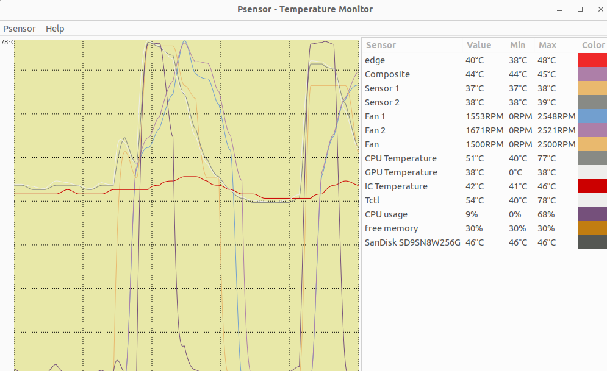
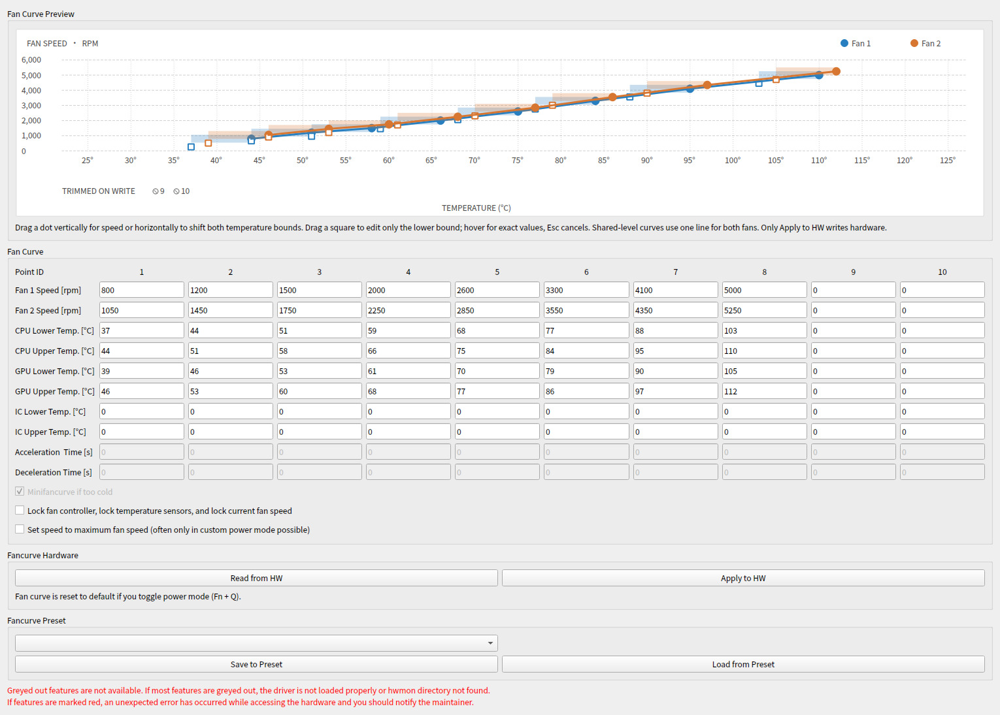
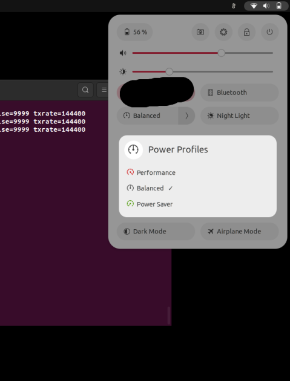

# Usage

**you have to install the kernel module permanently (see [Permanent Install Instruction](installation.md#permanent-install-instruction)), otherwise you must reload it manually after each restart**

## Temperature and Fan Monitoring

The temperatures and fan speeds should be displayed in any graphical tool that monitors them, e.g. psensor. You have to install it first before running:

```bash
psensor
```

<p align="center">
    
</p>

## Changing and Setting your own Fan Curve with the Python GUI

On models with sensors but no custom fan curve support, the GUI skips the
unavailable fan curve at startup. Fan curve Read/Apply controls remain disabled.
Other Options remains available for settings supported by the laptop.

Start the GUI as root

```bash
# run from folder LenovoLegionLinux
sudo python/legion_linux/legion_linux/legion_gui.py
```

<p align="center">
    
</p>

The screenshot uses example data, not a hardware readback.

- with `Read from HW` you can read the current fan curve that is saved in the hardware and display it.
- the current fan curve is loaded automatically at start-up when the kernel module is present; otherwise the fan curve starts empty and `Read from HW` is greyed out
- when the power mode changes externally (for example with Fn+Q) while `legiond` is running, the GUI re-reads the fan curve once the daemon has applied the preset for the new mode, so the table does not go stale. The refresh is read-only and is skipped while you have unsaved edits in the table; it can be disabled with `Refresh Fan Curve when the Power Mode Changes` in the `Automation` tab
- you can edit the values of the fancurve. They will not applied to hardware until your press `Apply to HW`
- the preview above the table updates while you type. Blue/orange lines show fan 1/2 speeds; on models with writable temperatures, shaded spans show CPU/GPU lower–upper hysteresis bands. Temperature-axis ticks are spaced at 5°C. On speed-only models, the horizontal axis shows point IDs instead of invented temperatures. For WMI level curves, the vertical axis shows firmware levels (not a guessed linear RPM scale).
- drag a filled point vertically to change its speed or horizontally to move its writable CPU/GPU temperature bounds together (preserving the hysteresis gap); drag the square at the left edge of a shaded band to change only its lower bound. On models with only an upper temperature field, horizontal dragging changes only that upper bound. Hover to see exact speeds and temperatures; press Esc during a drag to restore the original values. Shared-level models show one line for both fans, with both RPM values in the hover tooltip. Level drags snap to the firmware RPM ladder and obey each point's minimum level; disabled fields and crossed hollow trailing padding points cannot be dragged. The hardware point count (up to 10) is respected. Always review the table before applying.
- press `Apply to HW` to write the currently displayed fancurve to hardware and activate it
- you can load and save a fancurve to a preset. Select the preset with the drop-down menu and press `Load from Preset` or `Save to preset`.
- loading a preset will just display it. You still have to press `Apply to HW` to activate it
- presets are stored in a yaml file in `/root/.config/legion_linux/`. You can edit them also manually.
- the number of points is fixed depending on power mode. Deactivated points are currently displayed as `0`s.
- lock fan controller: enabling this will freeze the current fan speed and the temperatures used to control the fan controller

Unexpected:

- an error is displayed or everything is `0`: kernel module not loaded or installed (see [Installation](installation.md)) or not compatible (do the [manual tests](initial-testing.md))
- an value is not accepted when `Write to HW`: the value is out-of-range and was not accepted by hardware

## Changing and Setting your own Fan Curve with the Python CLI

You can do the same as the GUI from a CLI program. It will access the same presets.

```bash
# run from folder LenovoLegionLinux
sudo python/legion_linux/legion_linux/legion_cli.py
```

```text
usage: legion_cli.py [-h] {fancurve-write-preset-to-hw,fancurve-write-hw-to-preset,fancurve-write-file-to-hw,fancurve-write-hw-to-file} ...

Legion CLI

options:
  -h, --help            show this help message and exit

subcommands:
  {fancurve-write-preset-to-hw,fancurve-write-hw-to-preset,fancurve-write-file-to-hw,fancurve-write-hw-to-file}
    fancurve-write-preset-to-hw
                        Write fan curve from preset to hardware
    fancurve-write-hw-to-preset
                        Write fan curve from hardware to preset
    fancurve-write-file-to-hw
                        Write fan curve from file to hardware
    fancurve-write-hw-to-file
                        Write fan curve from hardware to file
```

## Creating and Setting your own Fan Curve with Script

Just run the script to set the fan curve. It is in the folder `LenovoLegionLinux`.

```bash
# Go to folder LenovoLegionLinux and run it. It should output "Writing fancurve successful!" if it finishes successful
sudo ./setmyfancurve.sh
# And check new fan curve
sudo cat /sys/kernel/debug/legion/fancurve
```

Open the file `setmyfancurve.sh` and edit it to adapt the values in the script to create your own fan curve. Follow the description in the file.

Unexpected output:

- `bash: ./setmyfancurve.sh: Permission denied`: You have to make the script executable with `chmod +x ./setmyfancurve` first
- script does not end with "fancurve set": maybe path to hwmon changed; Please report this

Note:

- **If you want to reset your fan curve, just toggle with Ctrl+Q or Fn+Q the power mode or restart and everything is gone.**
- Currently, the hardware resets the fan curve randomly or if you change power mode, suspend, or restart. Just run the script again.
- You might want to create different scripts for different usages. Just copy it and adapt the values.

## Change power mode from software

For this to work, you must install the kernel module permanently (see [Permanent Install Instruction](installation.md#permanent-install-instruction)). Alternatively, you can restart the the power daemon (`systemctl restart power-profiles-daemon.service` in Ubuntu) after reloading the kernel module (see [Build and Test Instruction](installation.md#build-and-test-instruction)).

### Modify/Control with GUI

With the GUI, the current power mode can be changed by selecting the mode in the box labeled with `Power mode/platform profile`. The dropdown prefers `legion_laptop`'s own platform profile (the only provider that offers `custom`/`max-power` on supported models); if the module is not loaded, it falls back to any other registered platform-profile provider (e.g. `ideapad-laptop`), so the mode can still be switched.

### Modify/Control with Widget

In Ubuntu/Gnome go to `Settings->Power->Power Mode/Power Saving Option` or the applet in the top right.

<p align="center">
    
</p>
Automatic change of power mode can be changed in the settings of the distribution ( in Ubuntu).

### Modify with CLI

```bash
# List all profiles (power-saver = quiet= blue)
powerprofilesctl list

#   performance:
#     Driver:     platform_profile
#     Degraded:   no

#   balanced:
#     Driver:     platform_profile

# * power-saver:
#     Driver:     platform_profile

# Set a profile, e.g. power-saver=quiet
powerprofilesctl set power-saver
# or balanced
powerprofilesctl set balanced
# or performance
powerprofilesctl set performance
```

Alternatively, you can also directly access it on a lower level:

```bash
# Access current profile
cat /sys/firmware/acpi/platform_profile

# Change current profile (AS ROOT): available modes quiet, balanced, performance, balanced-performance
# quiet = power-saver
echo quiet > /sys/firmware/acpi/platform_profile
# or balanced
echo balanced > /sys/firmware/acpi/platform_profile
# or performance
echo performance > /sys/firmware/acpi/platform_profile
# or custom-mode = balanced-performance (not available on all models); the LED should turn pink/purple
echo balanced-performance > /sys/firmware/acpi/platform_profile
```

### Custom Power Mode

If you model support the custom power mode, then you can:

- enter custom power mode
- LED should turn pink/purple
- customnize CPU/GPU boost and TGP settings

You can change to it with in the GUI: Open the GUI and select "Custom Mode" for power profile. Alternativley, you can change to it with in the command line with:

```bash
echo balanced-performance > /sys/firmware/acpi/platform_profile
```

Unfortunately, the `power-profile-deamon` or `powerprofilesctl` currently do not support this mode.

## Enable or disable the mini fan curve

If the laptop stays cool for a longer time, it will enable the "mini fan curve", a special fan curve with only a few points. It will usually spin the fans. You can enable or disable that. If you want to use your configured fan curve in any case, disable it. The mini fan curve is not available on all models (you will see error for mini fan curve when running `cat /sys/kernel/debug/legion/fancurve`).

With the GUI, the mini fan curve is enabled/disabled by checking/unchecking the box `Minifancurve if cold` and pressing `Apply to HW`.

## Lenovo Legion Laptop Support Daemon(legiond)

The LLL daemon (`legiond`) is a small C program (see [extra/service/legiond](../extra/service/legiond/)) supported on Systemd and OpenRC (experimental).
If you install LLL manually (not through the package manager), you need to build `legiond` yourself (`make` in [extra/service/legiond](../extra/service/legiond/), requires `libinih`) and install the binaries, service files, and example profiles — see [README.org](../extra/service/legiond/README.org) for the setup.

This daemon automatically switches between the fan profiles set in the GUI depending on the power mode and whether the laptop is plugged in or not.
These are the profiles available:

- quiet-battery - Fan Profile on quiet mode on battery
- balanced-battery - Fan Profile on balance mode on battery
- balanced-performance-battery - Fan Profile on custom mode on battery
- performance-battery - Fan Profile on performance mode on battery
- quiet-ac - Fan Profile on quiet mode on charger
- balanced-ac - Fan Profile on balance mode on charger
- balanced-performance-ac - Fan Profile on custom mode on charger
- performance-ac - Fan Profile on performance mode on charger
- extreme-ac - Fan Profile on extreme mode on charger

Example profiles are [here](../extra/service/profiles) can also be set via the gui for easy set up:
1 - Set the `Fan Curve` you like to use
2 - Chose on the profile above in `Fancurve Preset` and hit Save to Preset (will ask for you password)
3 - Set all the profiles
4 - Go to the `Automation` tab and enable the option `Lenovo Legion Laptop Support Daemon Enable`

This systemd service also have extras features that can be activated by editing [legiond.ini](../extra/service/legiond.ini) located /etc/legion_linux/legiond.ini:

- cpu_control - activate use of RyzenADJ on AMD or undervolt on Intel to make custom cpu setting for each power mode
  - bat_bp - Custom Cpu setting for custom mode on battery
  - ac_bp - Custom Cpu setting for custom mode on charger
  - bat_q - Custom Cpu setting for quiet mode on battery
  - ac_q - Custom Cpu setting for quiet mode on charger
  - bat_b - Custom Cpu setting for balance mode on battery
  - ac_b - Custom Cpu setting for balance mode on charger
  - ac_p - Custom Cpu setting for performance mode on charger
- gpu_control:
  - nvidia - use ```nvidia-smi -pl``` command to change the TDP of the GPU (only work on driver 525 and lower)
  - radeon - use ```rocm-smi --setpoweroverdrive``` command to change the TDP of the GPU

    - tdp_bat_bp - Custom GPU TDP for custom mode on battery
    - tdp_ac_bp - Custom GPU TDP for custom mode on charger
    - tdp_bat_q - Custom GPU TDP for quiet mode on battery
    - tdp_ac_q - Custom GPU TDP for quiet mode on charger
    - tdp_bat_b - Custom GPU TDP for balance mode on battery
    - tdp_ac_b - Custom GPU TDP for balance mode on charger
    - tdp_ac_p - Custom GPU TDP for performance mode on charger
  - Note: The default values in the `legiond.ini` file are from RTX 3070

NOTE: `legiond` watches power-state and power-profile changes directly via inotify, so it no longer depends on `acpid.service`.
If your CPU tweaks often get reset to default, enable `legiond-cpuset.timer` to override it.

See [README.org](../extra/service/legiond/README.org)

## Lift the Firmware Fan Ceiling (fan unlock)

On supported models the firmware caps the maximum fan speed below what the hardware can do. The `fan_unlock` sysfs attribute lifts this ceiling. It is only exposed on validated model/BIOS combinations (see the `has_fan_unlock` allowlist in `kernel_module/legion-laptop.c`); on the Legion Pro 7 16IRX8H (BIOS KWCN54WW) it raises the cap from ~4400 RPM to ~7100 RPM. On the Legion Y530-15ICH (BIOS 8JCN56WW) the same firmware call switches the Fn+Q "extreme cooling" mode (both fans to ~4000 RPM); there `fan_unlock` reads the live firmware state, so a toggle via Fn+Q is reported as well.

```bash
# Check status / enable / disable
sudo legion_cli fan-unlock-status
sudo legion_cli fan-unlock-enable
sudo legion_cli fan-unlock-disable

# Or directly via sysfs
cat /sys/module/legion_laptop/drivers/platform:legion/PNP0C09:00/fan_unlock
```

## Lock and Unlock the Fan Controller and Fan Speed

You can lock the current fan speed. If it is locked, the fan speed will stays constant and does not react to temperature changes. You might want to lock the fan at a high speed during a game. I would not recommend keeping it locked all the time. If your fan controller gets locked accidentally, e.g. by Windows tools, you can unlock it. A locked fan controller might be the reason for a non-working fan control. If the fan controller is locked, the additional temperature sensors are not updated anymore and also stay constant.

With the GUI, the fan controller is locked by checking the box `Lock fan controller` and pressing `Apply to HW`.

## Set Speed to Maximum Fan Speed

The fan can be set to maximum fan speed regardless of temperature. This is sometimes called extreme cooling mode or dust cleaning mode. Do not enable this for long periods of time, because it might degrade your fans faster.

With the GUI, the current fan speed is set to the maximum possible value by checking `Set speed to maximum fan speed` and pressing `Apply to HW`.

This is currently not available in many models.

## Set Battery Conservation Mode to Prolong Battery Life when AC is plugged in

You can enable battery conservation mode. When conservation mode is enabled, the constant charging of the battery is disabled when the AC (charger) is plugged in. It will try to keep your battery state of charge at around 50%. This is said to prolong the battery life.

With the GUI, the battery conservation is enabled by checking the box `Battery conservation` (changes should apply immediately).

Conservation mode and rapid charging are mutually exclusive: enabling conservation mode (`battery_conservation`) switches rapid charging off first, and enabling rapid charging switches conservation mode off (done by the firmware). Disabling conservation mode leaves rapid charging off.

## Toggle Fn lock to use special functions on F1-F12 keys without pressing Fn key

You can lock the Fn keys. You can do it by pressing Fn+Esc. This should also toggle the light in the Esc key (if available in your model).
If enabled, the special functions, e.g. increase sound volume on F3, is triggered without pressing Fn.

With the GUI, the Fn-lock is enabled/disabled by checking/unchecking the box `Fn Lock` (changes should apply immediately).

## Enable/Disable Touch Pad

You can enable or disable the touch pad. You can do it by pressing Fn+F10 (or similar).

With the GUI, the touch pad is enabled/disabled by checking/unchecking the box `Touch Pad Enabled` (changes should apply immediately).

## Keyboard Backlight

- 4 Zone RGB backlight: please use https://github.com/4JX/L5P-Keyboard-RGB
- off/on white backlight or off/medium/bright white backlight: supported by this software but can be controlled by all programs for LED control in linux
