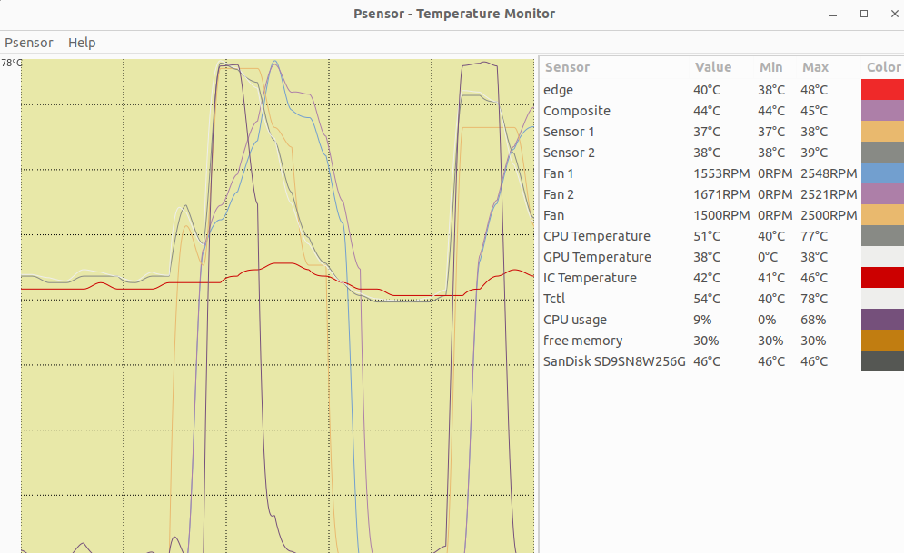
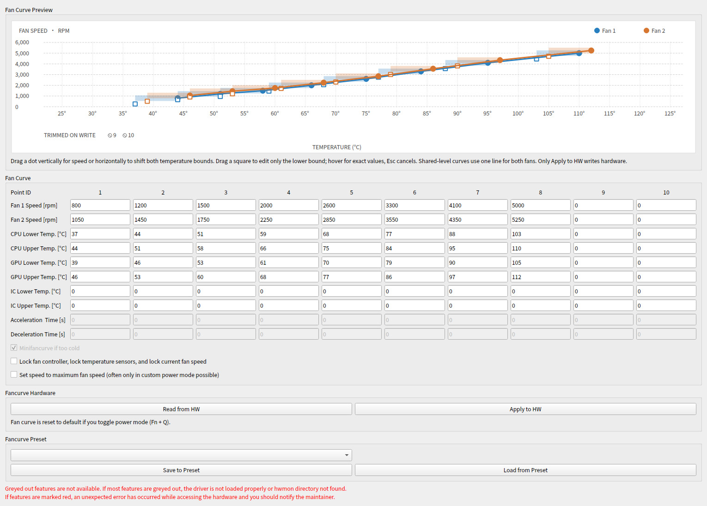
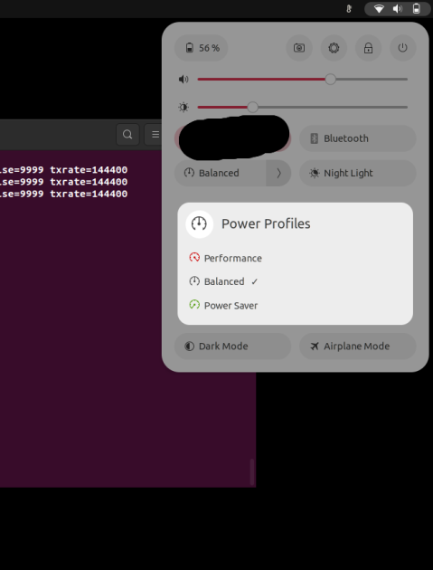

# 使用指南

**你必须永久安装内核模块（见[永久安装说明](installation.md#永久安装说明)），否则每次重启后都需要手动重新加载内核模块**

## 温度与风扇监控

温度和风扇转速可以在任何监控这些参数的图形化工具中显示，例如 psensor。你需要先安装它，然后运行：

```bash
psensor
```

<p align="center">
    
</p>

## 使用 Python GUI 更改和设置自定义风扇曲线

对于支持传感器但不支持自定义风扇曲线的机型，GUI 启动时会跳过风扇曲线读取，
并禁用风扇曲线的读取和应用按钮。仍可在“Other Options”中使用机型支持的设置。

以 root 身份启动 GUI

```bash
# 在 LenovoLegionLinux 文件夹下运行
sudo python/legion_linux/legion_linux/legion_gui.py
```

<p align="center">
    
</p>

截图使用的是示例数据，并非硬件回读。

- 点击 `Read from HW` 可以读取并显示保存在硬件中的当前风扇曲线。
- 如果内核模块已加载，启动时会自动读取当前风扇曲线；否则曲线初始为空，`Read from HW` 按钮不可用。
- 当电源模式在外部发生变化（例如按下 Fn+Q）且 `legiond` 正在运行时，GUI 会在守护进程应用新模式对应的预设后重新读取风扇曲线，避免表格数据过时。该刷新操作只读；当表格中存在未保存的修改时会跳过。可在 `Automation` 标签页中通过 `Refresh Fan Curve when the Power Mode Changes` 选项关闭。
- 你可以编辑风扇曲线的各项数值。只有点击 `Apply to HW` 后，修改才会写入硬件并生效。
- 表格上方的预览会随输入实时更新。蓝/橙色线分别表示风扇 1/2 转速；支持设置温度的机型会用半透明区间显示 CPU/GPU 温度下限和上限（回差区间），温度轴每隔 5°C 显示刻度。只能设置转速的机型以曲线点编号为横轴，不虚构温度；WMI 等级曲线以固件等级为纵轴，不使用猜测的线性 RPM 换算。
- 纵向拖动实心点修改转速，横向拖动时 CPU/GPU 温度上下限一起移动（保持回差宽度）；拖动半透明区间左端的小方块可单独修改温度下限。仅支持温度上限的机型，横向拖动只修改上限。悬停可查看具体转速和温度，拖动时按 Esc 可恢复原值。共享等级机型只绘制两台风扇共用的一条曲线；悬停提示显示各自的 RPM。等级曲线会依固件 RPM 表吸附并遵守每个点的最低等级；不可写字段和标有叉号的空心尾部填充点不能拖动。遵守硬件支持的点数（最多 10 个）。应用前请检查表格数值。
- 点击 `Apply to HW` 可将当前显示的风扇曲线写入硬件并激活。
- 你可以将风扇曲线保存为预设或从预设加载。通过下拉菜单选择预设，然后点击 `Load from Preset` 或 `Save to preset`。
- 加载预设只会显示内容，必须点击 `Apply to HW` 才会激活到硬件。
- 预设以 yaml 文件的形式保存在 `/root/.config/legion_linux/`，你也可以手动编辑这些文件。
- 风扇曲线点的数量依据电源模式而定。未激活的点当前显示为 `0`。
- 锁定风扇控制器：启用后会冻结当前风扇转速和用于控制风扇的温度。

异常情况：

- 显示错误或所有值为 `0`：内核模块未加载或未安装（见[安装](installation.md)）或不兼容（请进行[手动测试](initial-testing.md)）。
- 使用 `Write to HW` 写入硬件时某个值被拒绝：说明该值超出硬件允许范围。

## 使用 Python CLI 更改和设置自定义风扇曲线

你也可以通过 CLI 程序实现和 GUI 相同的功能，并可访问相同的预设。

```bash
# 在 LenovoLegionLinux 文件夹下运行
sudo python/legion_linux/legion_linux/legion_cli.py
```

```text
usage: legion_cli.py [-h] {fancurve-write-preset-to-hw,fancurve-write-hw-to-preset,fancurve-write-file-to-hw,fancurve-write-hw-to-file} ...

Legion CLI

options:
  -h, --help            显示帮助信息并退出

子命令:
  {fancurve-write-preset-to-hw,fancurve-write-hw-to-preset,fancurve-write-file-to-hw,fancurve-write-hw-to-file}
    fancurve-write-preset-to-hw
                        将预设中的风扇曲线写入硬件
    fancurve-write-hw-to-preset
                        将硬件中的风扇曲线写入预设
    fancurve-write-file-to-hw
                        将文件中的风扇曲线写入硬件
    fancurve-write-hw-to-file
                        将硬件中的风扇曲线写入文件
```

## 使用脚本创建并设置自定义风扇曲线

只需运行脚本即可设置风扇曲线。脚本位于 `LenovoLegionLinux` 文件夹中。

```bash
# 进入 LenovoLegionLinux 文件夹并运行脚本。如果成功完成，应该会输出 "Writing fancurve successful!"
sudo ./setmyfancurve.sh
# 检查新的风扇曲线
sudo cat /sys/kernel/debug/legion/fancurve
```

打开 `setmyfancurve.sh` 文件，编辑其中的数值以自定义你的风扇曲线。具体请参考文件中的说明。

异常输出：

- `bash: ./setmyfancurve.sh: Permission denied`：你需要先用 `chmod +x ./setmyfancurve` 让脚本具有可执行权限
- 脚本未以 "fancurve set" 结尾：可能 hwmon 路径发生了变化，请向项目反馈此问题

注意事项：

- **如果你想重置风扇曲线，只需按下 Ctrl+Q 或 Fn+Q 切换电源模式，或重启系统即可恢复默认。**
- 目前，硬件可能会随机重置风扇曲线，或者在你更换电源模式、挂起、重启时重置。此时只需重新运行脚本即可。
- 你可以为不同的使用场景创建不同的脚本。只需复制脚本并调整相关数值即可。

---

## 通过软件更改电源模式

要使用此功能，必须永久安装内核模块（见[永久安装说明](installation.md#永久安装说明)）。或者，在重新加载内核模块后，重启电源守护进程（Ubuntu 下为 `systemctl restart power-profiles-daemon.service`）。

### 使用 GUI 修改/控制

通过 GUI，可以在标有 `Power mode/platform profile` 的框中选择当前电源模式。下拉框优先使用 `legion_laptop` 自己的 platform profile（只有它在受支持机型上提供 `custom`/`max-power`）；如果模块未加载，则回退到其他已注册的 platform-profile 提供方（例如 `ideapad-laptop`），仍然可以切换电源模式。

### 使用小部件修改/控制

在 Ubuntu/Gnome 中，进入 `设置->电源->电源模式/节能选项` 或使用右上角的小程序进行切换。

<p align="center">
    
</p>

自动切换电源模式可以在发行版的设置中更改（如 Ubuntu）。

### 使用 CLI 修改

```bash
# 列出所有配置文件（power-saver = 静音 = 蓝色）
powerprofilesctl list

#   performance:
#     Driver:     platform_profile
#     Degraded:   no

#   balanced:
#     Driver:     platform_profile

# * power-saver:
#     Driver:     platform_profile

# 设置某个配置，例如 power-saver=静音
powerprofilesctl set power-saver
# 或平衡
powerprofilesctl set balanced
# 或高性能
powerprofilesctl set performance
```

你也可以用更底层的方式直接访问：

```bash
# 查看当前配置
cat /sys/firmware/acpi/platform_profile

# 更改当前配置（需要ROOT权限）：可用模式有 quiet、balanced、performance、balanced-performance
# quiet = 节能
echo quiet > /sys/firmware/acpi/platform_profile
# 或平衡
echo balanced > /sys/firmware/acpi/platform_profile
# 或高性能
echo performance > /sys/firmware/acpi/platform_profile
# 或自定义模式 = balanced-performance（并非所有型号都支持）；LED 会变为粉色/紫色
echo balanced-performance > /sys/firmware/acpi/platform_profile
```

### 自定义电源模式

如果你的机型支持自定义电源模式，可以：

- 进入自定义电源模式
- LED 会变为粉色/紫色
- 可自定义 CPU/GPU 的加速和 TGP 设置

你可以在 GUI 中选择 "Custom Mode" 进入自定义模式。或者，也可以用命令行切换：

```bash
echo balanced-performance > /sys/firmware/acpi/platform_profile
```

遗憾的是，目前 `power-profile-deamon` 或 `powerprofilesctl` 还不支持该模式。

## 启用或禁用迷你风扇曲线

如果笔记本长时间保持低温，会启用“迷你风扇曲线”，这是一种只包含少量节点的特殊风扇曲线，通常会让风扇持续转动。你可以选择启用或禁用它。如果你希望始终使用自己配置的风扇曲线，请将其禁用。并非所有机型都支持迷你风扇曲线（如果不支持，运行 `cat /sys/kernel/debug/legion/fancurve` 时会看到相关错误）。

在 GUI 中，通过勾选或取消 `Minifancurve if cold` 选项并点击 `Apply to HW` 按钮来启用或禁用迷你风扇曲线。

---

## Lenovo Legion Linux 守护进程（legiond）

LLL 守护进程（`legiond`）是一个小型 C 程序（见 [extra/service/legiond](../../extra/service/legiond/)），支持 Systemd 和 OpenRC（实验性）。  
如果你是手动安装 LLL（不是通过包管理器），需要自行编译 `legiond`（在 [extra/service/legiond](../../extra/service/legiond/) 目录下运行 `make`，依赖 `libinih`），并手动安装二进制文件、service 文件和示例配置 —— 具体步骤见 [README.org](../../extra/service/legiond/README.org)。

该守护进程可以根据电源模式和是否插电，自动切换 GUI 中设定的风扇曲线配置文件。  
可用的配置文件如下：

- quiet-battery - 电池供电下安静模式风扇配置
- balanced-battery - 电池供电下平衡模式风扇配置
- balanced-performance-battery - 电池供电下自定义模式风扇配置
- performance-battery - 电池供电下高性能模式风扇配置
- quiet-ac - 充电器供电下安静模式风扇配置
- balanced-ac - 充电器供电下平衡模式风扇配置
- balanced-performance-ac - 充电器供电下自定义模式风扇配置
- performance-ac - 充电器供电下高性能模式风扇配置
- extreme-ac - 充电器供电下极致模式风扇配置

示例配置文件在 [这里](../../extra/service/profiles)，也可以通过 GUI 便捷设置：

1. 先设置你想要的 `Fan Curve`
2. 在 `Fancurve Preset` 选择上述某个配置文件，然后点击 `Save to Preset`（会要求输入密码）
3. 依次设置好所有配置文件
4. 进入 `Automation` 标签，启用 `Lenovo Legion Laptop Support Daemon Enable` 选项

此 systemd 服务还支持通过编辑 `/etc/legion_linux/legiond.ini`（即 [legiond.ini](../../extra/service/legiond.ini)）激活以下附加功能：

- cpu_control - 启用 AMD 下的 RyzenADJ 或 Intel 的降压功能，根据电源模式自定义 CPU 设置
  - bat_bp - 电池自定义模式下 CPU 设置
  - ac_bp - 充电器自定义模式下 CPU 设置
  - bat_q - 电池安静模式下 CPU 设置
  - ac_q - 充电器安静模式下 CPU 设置
  - bat_b - 电池平衡模式下 CPU 设置
  - ac_b - 充电器平衡模式下 CPU 设置
  - ac_p - 充电器高性能模式下 CPU 设置
- gpu_control:
  - nvidia - 使用 `nvidia-smi -pl` 命令调整 NVIDIA GPU 的 TDP（仅支持驱动 525 及以下）
  - radeon - 使用 `rocm-smi --setpoweroverdrive` 命令调整 Radeon GPU 的 TDP

    - tdp_bat_bp - 电池自定义模式下 GPU TDP
    - tdp_ac_bp - 充电器自定义模式下 GPU TDP
    - tdp_bat_q - 电池安静模式下 GPU TDP
    - tdp_ac_q - 充电器安静模式下 GPU TDP
    - tdp_bat_b - 电池平衡模式下 GPU TDP
    - tdp_ac_b - 充电器平衡模式下 GPU TDP
    - tdp_ac_p - 充电器高性能模式下 GPU TDP
  - 注意：`legiond.ini` 文件中的默认值来自 RTX 3070

注意：`legiond` 现在通过 inotify 直接监听电源状态/电源配置的变化，不再依赖 `acpid.service`。  
如果你的 CPU 调优经常被重置为默认值，请启用 `legiond-cpuset.timer` 来覆盖它。

详细见 [README.org](../../extra/service/legiond/README.org)

---

## 解除固件风扇转速上限（fan unlock）

在受支持的机型上，固件会将风扇最大转速限制在硬件实际能力之下。`fan_unlock` sysfs 属性可以解除该限制。它仅在经过验证的机型/BIOS 组合上暴露（见 `kernel_module/legion-laptop.c` 中的 `has_fan_unlock` 白名单）；在 Legion Pro 7 16IRX8H（BIOS KWCN54WW）上可将上限从约 4400 RPM 提升至约 7100 RPM。在 Legion Y530-15ICH（BIOS 8JCN56WW）上，同一固件调用用于切换 Fn+Q 的“极速散热”模式（双风扇约 4000 RPM）；该机型的 `fan_unlock` 读取的是固件实时状态，因此通过 Fn+Q 切换也会被反映出来。

```bash
# 查看状态 / 启用 / 禁用
sudo legion_cli fan-unlock-status
sudo legion_cli fan-unlock-enable
sudo legion_cli fan-unlock-disable

# 或直接通过 sysfs
cat /sys/module/legion_laptop/drivers/platform:legion/PNP0C09:00/fan_unlock
```

---

## 锁定与解锁风扇控制器和风扇转速

你可以锁定当前风扇转速。锁定后，风扇转速将保持不变，不会再随温度变化。如果你想在游戏时保持高转速，可以使用此功能，但不建议一直保持锁定。如果风扇控制器被 Windows 工具等意外锁定，你也可以解锁。风扇控制器被锁定时，温度传感器数据也不会更新。

在 GUI 中，勾选 `Lock fan controller` 并点击 `Apply to HW` 即可锁定风扇控制器。

---

## 设置风扇为最大转速

风扇可以设置为最大转速（极致散热/清灰模式），此时温度不会影响转速。请勿长时间开启此模式，否则可能加速风扇损耗。

在 GUI 中，勾选 `Set speed to maximum fan speed` 并点击 `Apply to HW` 即可。

注意：目前并非所有机型都支持此功能。

---

## 设置电池养护模式以延长电池寿命（接入电源时）

可以开启电池养护模式。开启后，插电时电池将不会持续充电，而是保持电量在 50% 左右，据说可延长电池寿命。

在 GUI 中，勾选 `Battery conservation` 即可开启（更改会立即生效）。

电池保护模式与快速充电互斥：开启电池保护模式（`battery_conservation`）时会先关闭快速充电；开启快速充电时固件会关闭电池保护模式。关闭电池保护模式后快速充电保持关闭。

---

## 切换 Fn 锁，使 F1-F12 键可直接调用特殊功能

你可以锁定 Fn 键，方法是同时按下 Fn+Esc（部分型号 Esc 键灯会同步点亮/熄灭）。开启后，F1-F12 键无需 Fn 也能直接调用如调节音量等特殊功能。

在 GUI 中，勾选或取消 `Fn Lock` 即可（更改会立即生效）。

---

## 启用/禁用触控板

你可以通过 Fn+F10（或类似组合）开启或关闭触控板。

在 GUI 中，勾选或取消 `Touch Pad Enabled` 即可（更改会立即生效）。

## 键盘背光

- 4 区 RGB 背光：请使用 https://github.com/4JX/L5P-Keyboard-RGB
- 白色背光的开/关或开/中/高三档：本软件支持，也可以通过所有 Linux 下的 LED 控制程序进行控制
